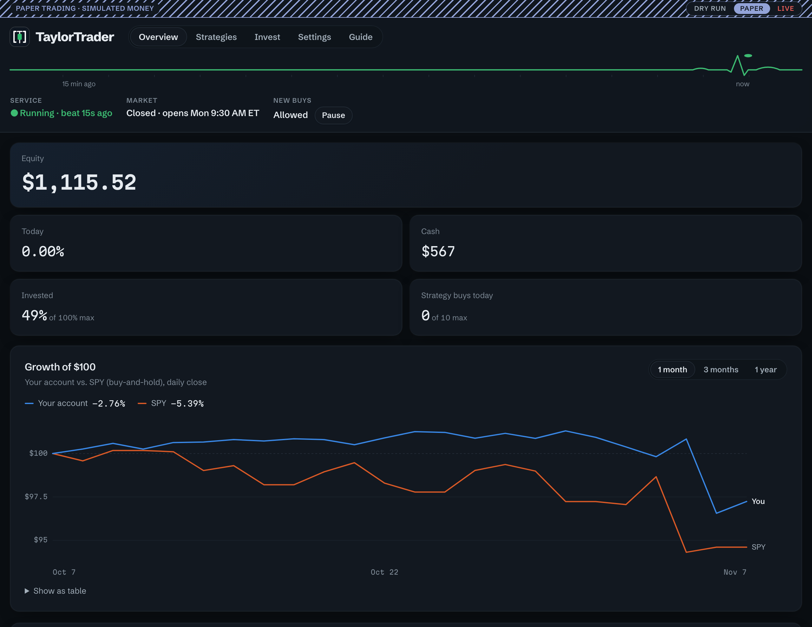
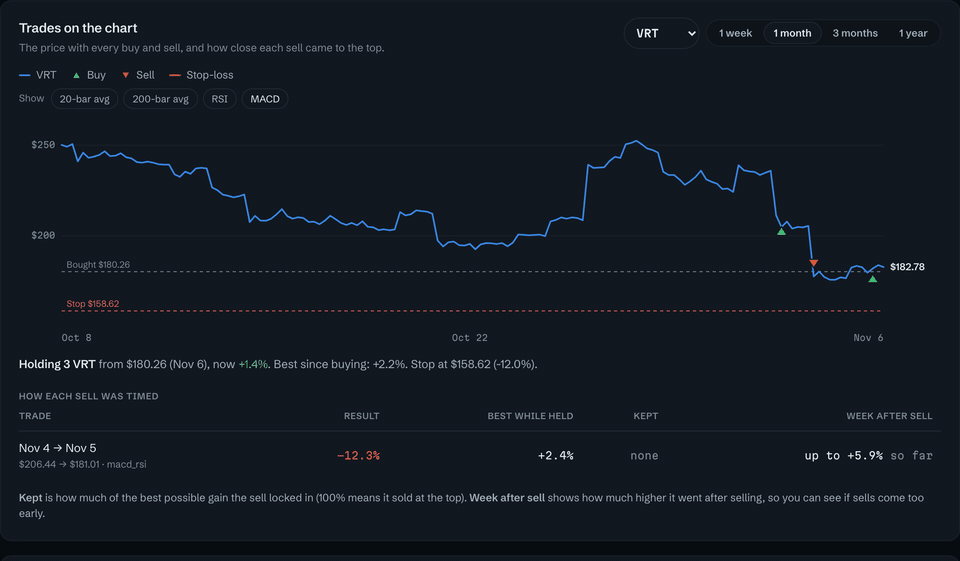
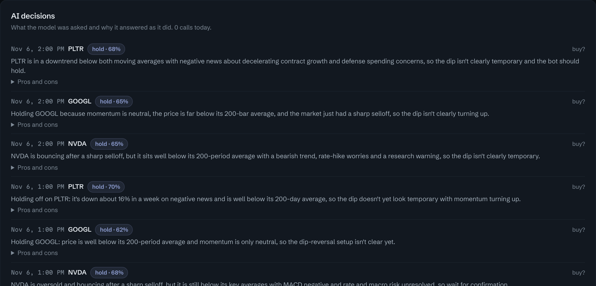
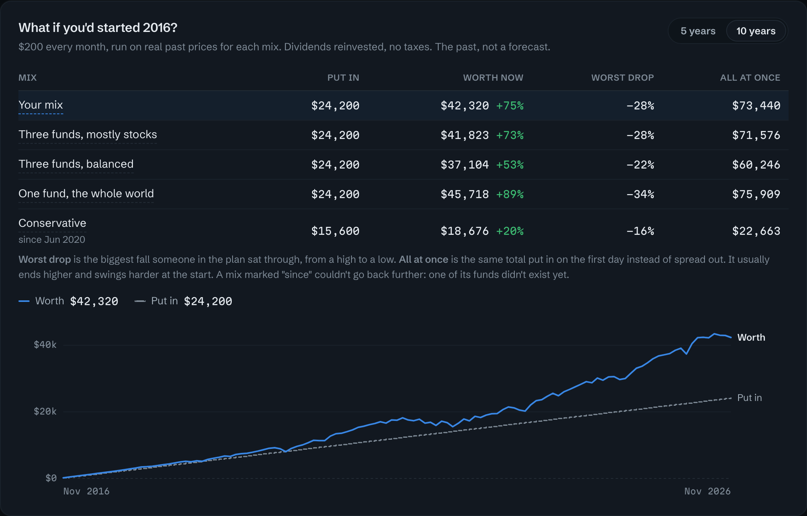
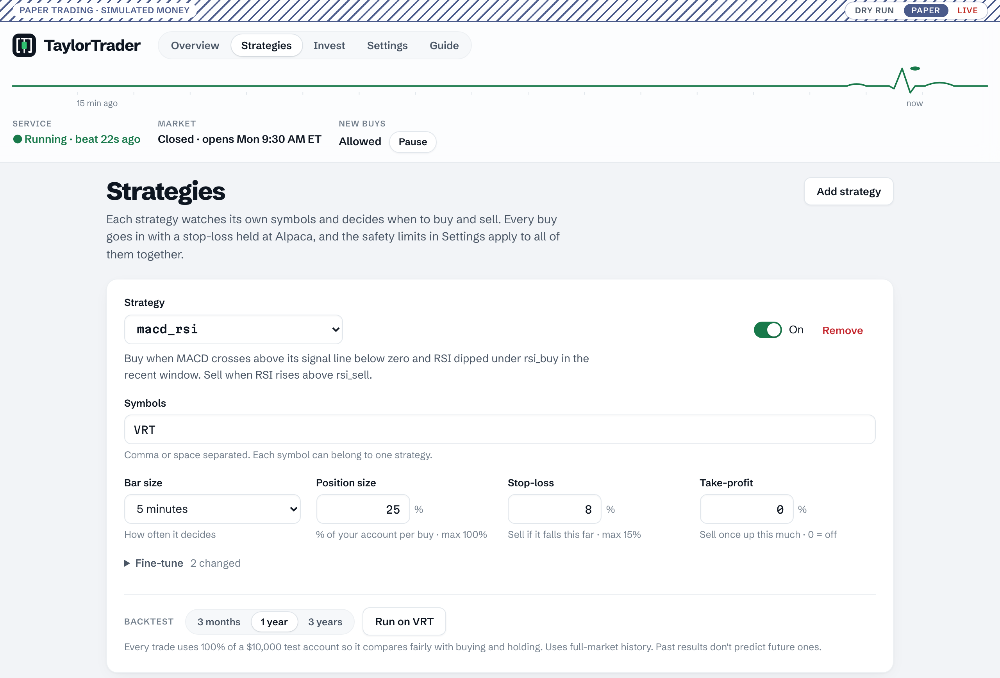
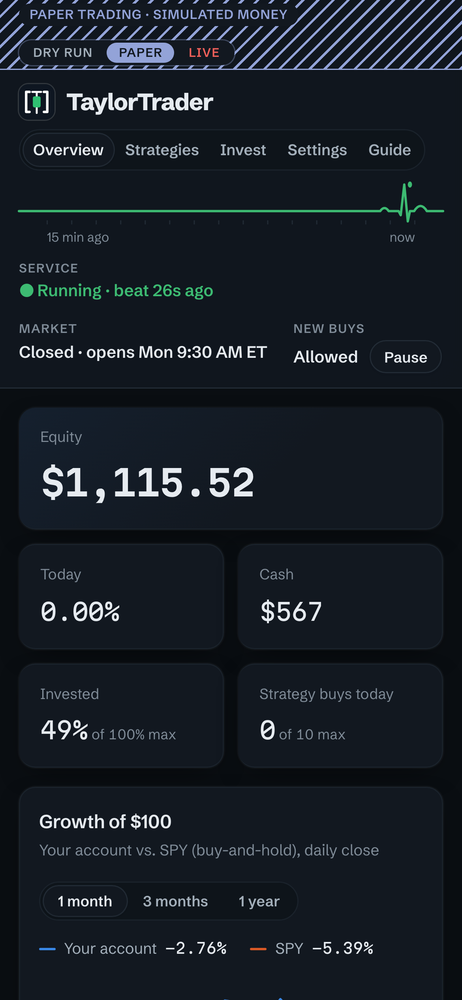

# TaylorTrader

**Set your strategies once, and let the bot watch the market for you.** TaylorTrader runs on your own
computer and trades your [Alpaca](https://alpaca.markets) account automatically: it checks prices all
day, buys and sells when your strategies say so, protects those trades with stop-losses, and tells you
what it did. Mix short-term trading strategies, an AI that makes the calls, and long-term investing on
a schedule. No staring at charts.



- **Runs on its own.** Once it's set up, it trades and invests by itself during market hours, checks
  that every position is protected, and sends you a summary after each close. You step in only when
  you want to.
- **Talk to it from Claude.** Describe an idea in plain English and Claude turns it into rules,
  backtests them against buying and holding, and adds the strategy when you say so. Ask how it's
  doing, pause it, or move a stock to another strategy, all in conversation.
- **An AI strategy that shows its work.** A language model decides buy, sell or hold, and explains
  every call with its confidence, pros and cons. A report card grades each call against what happened next.
- **Strategies without code.** Pick a built-in, or write rules like `close > ma_50 and rsi < 40`, and
  backtest them in a click.
- **Scheduled investing.** Put a set amount into a mix of funds every week or month, kept in balance,
  and see first how that plan would have done over the last 10 years.
- **On your phone.** Open the dashboard from your phone on your Wi-Fi, and get alerts for every buy,
  sell and problem.
- **Safety first.** Stop-losses held at Alpaca, limits on every order, and paper trading until you
  choose otherwise.

> **Not financial advice.** It trades on **paper** (simulated money) until you switch to live yourself.
> Trading can lose money, and you're responsible for every order it places. Provided as is, with no
> warranty (see the [license](https://github.com/brandonmtaylor/taylor-trader/blob/main/LICENSE.md)).

**Status:** early, and in a paper-trading trial.

## A quick tour

**Ask Claude.** With the MCP server connected, for example:
```text
You:    Add a strategy for NVDA and AMD: buy when they pull back to the 50-day average with RSI
        under 40, sell when RSI goes over 70.
Claude: Writes the rules, backtests them on both stocks against buying and holding, shows you
        the results, and adds the strategy once you say so.
```

**Every trade on the chart.** Each buy and sell, the stop-loss, and how much of the move each sell kept.
Hover for any bar's price, and add moving averages, RSI and MACD.



**The AI's reasoning, call by call.**



**What if you'd started 10 years ago?** Your investing plan, run on real past prices for each mix.



<table>
<tr>
<td width="62%"></td>
<td width="38%"></td>
</tr>
<tr>
<td>Set up strategies and backtest them against buying and holding, without code.</td>
<td>Open it from your phone on the same Wi-Fi, with a passcode.</td>
</tr>
</table>

## Install
**Platforms:** macOS is fully supported. Linux runs the dashboard, backtests and a foreground
`taylortrader run`, with keys in a `.env` file; running in the background is set up for macOS only so
far. Windows isn't supported.

You need a free [Alpaca](https://app.alpaca.markets/signup) paper account (email only, no money).
```bash
curl -LsSf https://astral.sh/uv/install.sh | sh   # once, if you don't have uv
uv tool install taylortrader
taylortrader                                      # opens the dashboard and walks you through setup
```
Setup takes about ten minutes: connect your Alpaca paper keys, pick a strategy and backtest it, check
the safety limits, optionally add phone or email alerts, and start the bot in **dry run** (it decides
and alerts, but places no orders). Then switch between Dry run, Paper and Live at the top of the page.

Settings, the trade journal and logs live in `~/Library/Application Support/TaylorTrader` on macOS
(`~/.local/share/taylortrader` on Linux). Update with `uv tool upgrade taylortrader`. The dashboard's
**Guide** page explains everything in plain language.

### Does my computer need to stay on?
The bot only checks prices while your computer is awake, so a Mac that stays on (a Mac mini, or a
laptop left plugged in and open) works best. On a laptop that sleeps:
- Your stop-losses keep protecting open positions, because they're held at Alpaca, not on your computer.
- Strategies on daily bars miss little; ones on 1- to 15-minute bars miss whatever happens while it sleeps.
- The invest plan catches up: a buy that comes due while the laptop is asleep goes in when it wakes.
- The watchdog may send a "not running" alert after the laptop wakes up.

### From your phone
`taylortrader wifi on` prints a passcode and the address to open (`http://<your-mac>.local:8787`).
Each device signs in once and stays signed in for 30 days. Going live, changing API keys, and turning
real-money buying back on after a pause only work on the Mac itself. It's plain http, so use it on a
home network you trust; for anywhere else, put the Mac and phone on [Tailscale](https://tailscale.com).
`wifi off` closes it again.

## Talk to it from Claude (MCP)
TaylorTrader includes an MCP server, so Claude Code or the Claude desktop app can check on the bot and
adjust it: "how did the AI strategy do this week?", "move PLTR to macd_rsi", "backtest rsi_14 on NVDA
hourly", or describe an idea and let Claude write the rules and test it. It's optional; the bot runs
the same without it.

- **Claude Code:** [install it](https://claude.com/claude-code), then run once:
  ```bash
  claude mcp add taylortrader --scope user -- taylortrader mcp
  ```
- **Claude desktop app:** Settings, then Developer, then Edit Config. Add this to the file (merge it if
  it already has `mcpServers`) and reopen the app:
  ```json
  { "mcpServers": { "taylortrader": { "command": "/full/path/to/taylortrader", "args": ["mcp"] } } }
  ```
  The desktop app needs the full path (`which taylortrader` prints it).

The dashboard's **Settings** page, under Claude, shows both filled in for your computer, with copy
buttons. Then ask Claude "how's my trading bot doing?" to check it's connected. The dashboard doesn't
need to be open.

It uses the same rules as the dashboard: every change is checked, hard limits still apply, and changes
are logged as coming from Claude. It can't go live, read or change keys, loosen limits on a live
account, or turn buying back on after you pause it. Selling on a live account is off unless you turn
on **Let Claude sell on a live account** in Settings, on your Mac.

## AI strategy (experimental)
`ai` asks a language model whether to buy, sell or hold, using your plain-English instructions, recent
bars, indicators, and optionally the last 3 days of news. It works with:
- **Your Claude subscription** through [Claude Code](https://claude.com/claude-code) (`claude -p`, with
  no tools and none of your own settings). No API key; calls count toward your plan.
- **The Claude API**, billed per call. The sturdier choice for running unattended.
- **Any OpenAI-compatible API**: OpenAI, OpenRouter, Groq, or a free local model through Ollama or
  LM Studio.

The model only proposes. Position size, the stop-loss and every limit still apply, and an error, an
off-menu answer or low confidence means hold. A daily call limit caps cost.

It can't be backtested honestly, so the backtester refuses it: try it in dry run, then on paper.
`taylortrader replay` tests it on past bars with each stock disguised, so the model can't recall what
happened next.

## Strategies
Built-ins: `macd_rsi`, `macd`, `ma_20`, `rsi_14`, `ma_20_rsi`, `ma_200_rsi`, `ma_20_over_200_rsi`,
`chaikin`, `pullback`. Each symbol belongs to one strategy, so
it's always clear who manages a position.

Or write your own with `rule`: a buy rule and a sell rule, like `close > ma_50 and rsi < 40` or
`close > prev_high_20`. Rules can use price, volume, MACD and Chaikin, plus these at any length up to
250 bars: `ma_N`, `ema_N`, `high_N`, `low_N`, `change_N` (percent), `avg_volume_N`, `rsi_N`, `atr_N`.
Rules are parsed, never run as code.

**Test an idea before trusting it.** The backtester always compares against buying and holding.
`taylortrader search` goes further: it tunes on older data, then tests once on held-back data, and
checks the result against random entries, so luck doesn't pass for skill.

**Machine learning, for research.** `taylortrader search --grid ml` puts a machine-learning strategy
through the same tests. A tree model is retrained as time moves forward, only ever on bars whose
outcome was already known, and buys when it thinks a rise is likely. It's research-only, so it can't
be picked for trading. It needs an extra: `uv tool install 'taylortrader[ml]'`.

## Long-term investing
An **invest plan** puts a set amount into a fixed mix of funds on a schedule (say $200 a month into US
stocks, international stocks and bonds) and holds it.
- Each contribution goes to whatever is furthest under its target first, so new money keeps the mix
  balanced without selling. Fractional shares, so any amount splits exactly.
- A period is never bought twice, even across restarts: each buy is recorded first and carries an
  order id Alpaca won't accept twice.
- It invests cash already in your Alpaca account; it can't move money from your bank.
- Start in preview: it alerts what it would buy and places nothing. Buying for real asks you to type
  the amount and schedule.

The ready-made mixes are examples, not recommendations. What's built and what's planned is in the
[investing proposal](https://github.com/brandonmtaylor/taylor-trader/blob/main/docs/proposals/investing.md).

## Safety limits
- **Stop-losses live at the broker.** Every strategy buy is a bracket order with a stop-loss held by
  Alpaca, so the stop still works if TaylorTrader or your computer stops. A stop limits losses but can
  fill below its price when a stock gaps down or moves fast. (The invest plan doesn't use stops: holding
  through dips is its point.)
- **Every order is checked** against position size, total exposure, daily loss, buys per day, stop
  width, and a pause switch. Settings can tighten the built-in hard limits but never loosen them.
  Sells are never blocked.
- **It only manages what it bought.** Shares you already owned aren't touched, even if you add the
  symbol to a strategy.
- **Keys stay secret.** They live in the macOS Keychain (or a private `.env` file elsewhere), are
  masked in logs, and the dashboard never shows them again. Config files with secret-looking values
  are rejected.
- **Real money needs two steps:** live keys that open an active account, and typing `GO LIVE` in the
  dashboard on your Mac.
- **It tells you when something's wrong:** a missing stop, a refused order, prices that stopped
  arriving, a strategy that hasn't traded in two weeks, or the bot itself going quiet.

## Command line
Everything the dashboard does also works from a terminal:
```bash
taylortrader doctor                 # settings, credentials (found or missing), secret scan
taylortrader strategies             # what you can pick
taylortrader backtest VRT --strategy macd_rsi --timeframe 5Min --days 365
taylortrader account                # read-only: positions, stops, positions it doesn't manage
taylortrader alerts-test            # push and email test
taylortrader run --dry-run --once   # one check: decides and alerts, places no orders
taylortrader kill on                # pause new buys; sells and stops keep working
taylortrader journal                # recent orders and the heartbeat
taylortrader dashboard --background # keep the dashboard running (also --restart, --stop)
taylortrader wifi on                # open it to your phone on the same Wi-Fi
```
Settings live in `config.toml` with no secrets in it;
[config.example.toml](https://github.com/brandonmtaylor/taylor-trader/blob/main/config.example.toml)
explains each one. The bot notices a saved change and restarts itself with it, and a file with a
mistake in it is reported and ignored.

**Price data:** `feed = "yahoo"` (the default) covers every exchange and is current, but unofficial;
the bot switches to Alpaca IEX on its own if Yahoo fails or falls behind. `"iex"` is Alpaca, real
time, one exchange. Backtests use Alpaca's full-market (SIP) history.

## From source
```bash
git clone https://github.com/brandonmtaylor/taylor-trader && cd taylor-trader
uv sync
cd dashboard && npm install && npm run build && cd ..   # once, and after UI changes
uv run taylortrader                                     # uses this folder for settings and data
```
In a checkout, put `uv run` in front of every command above. See
[CONTRIBUTING.md](https://github.com/brandonmtaylor/taylor-trader/blob/main/CONTRIBUTING.md) to help
out, and [SECURITY.md](https://github.com/brandonmtaylor/taylor-trader/blob/main/SECURITY.md) to report
a problem privately.

## License
Source-available under the [Functional Source License 1.1, Apache 2.0 future
license](https://github.com/brandonmtaylor/taylor-trader/blob/main/LICENSE.md) (FSL-1.1-ALv2). Use it,
change it, run it for yourself, learn from it, contribute: all free. What it doesn't allow is selling
it, or a product built from it that does the same job, in competition with TaylorTrader. Each version
becomes plain Apache 2.0 two years after it's released.
